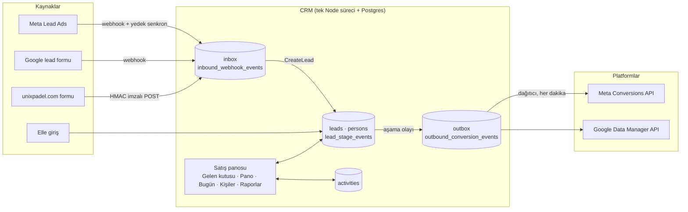
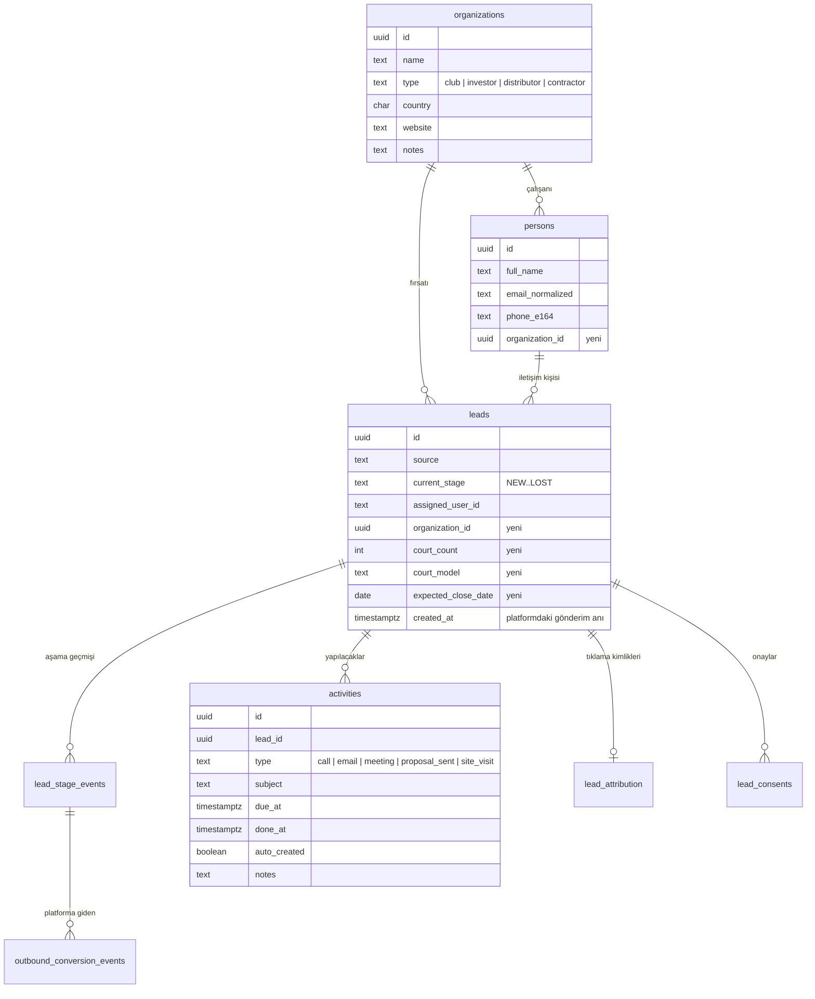
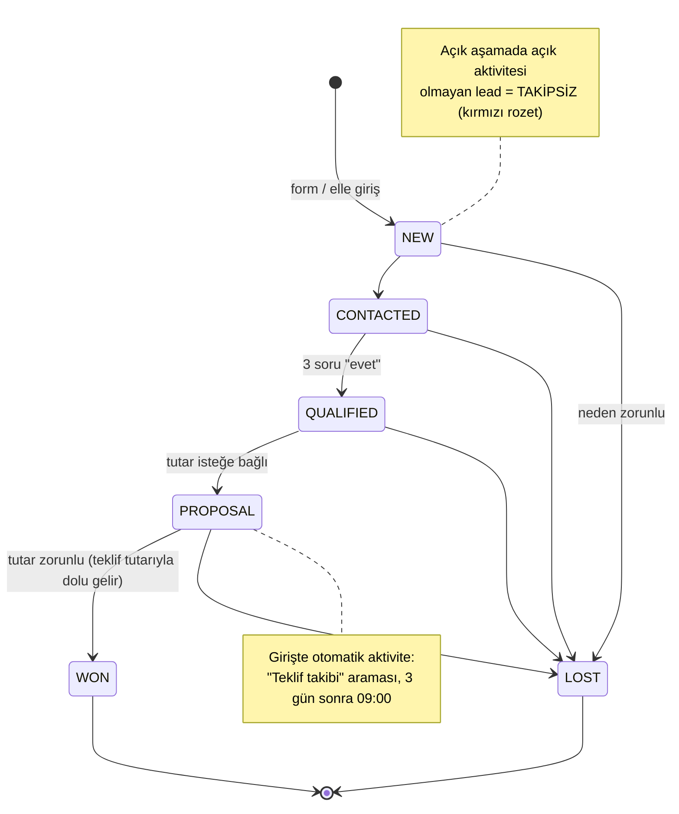
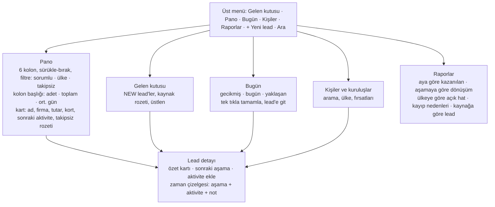
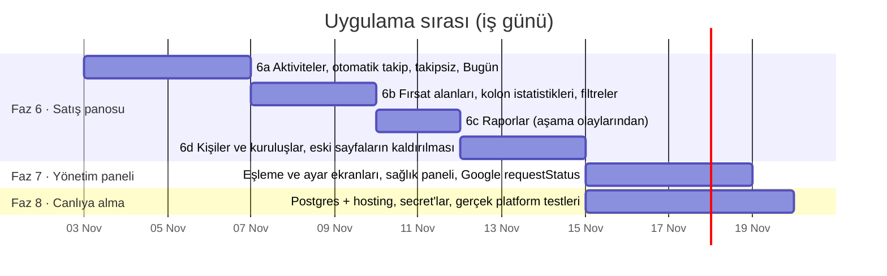
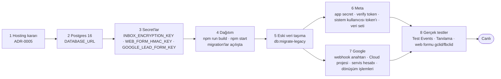

# Unixpadel CRM — yol haritası

Tarih: 2026-11-02. Bu belge iki modülü tek resimde toplar: **Lead → CRM entegrasyonu** (Faz 0–5, bitti) ve **satış
panosu** (Pipedrive benzeri fırsat yönetimi; eski uygulamada vardı, Faz 1'de eski veriyle askıda kaldı, şimdi yeni
veri modeli üzerinde geri geliyor). Sonunda canlıya alma adımları ve açık kararlar var.

## 1. Büyük resim

Tek kayıt: **Lead = fırsat.** Eski uygulamadaki "form kaydı → fırsata çevir" ayrımı yeni modelde aşamaya karşılık gelir:
gelen kutusundaki kayıt `NEW`, satışçı üstlenip ilerlettiğinde aynı kayıt panoda yürür. Pipedrive'daki "Leads Inbox →
Deals" akışıyla aynı mantık, kopyasız.

## 2. Bugün ne var, ne eksik

| Alan | Eski uygulama (JSON) | Bugün (Postgres, 6 aşama) | Eksik |
|---|---|---|---|
| Gelen kutusu, lead detayı, Kanban | — / 5 kolon | ✔ Faz 1 | Kartta tutar, kort sayısı, sonraki aktivite yok |
| Aşama kuralları | Kırmızı hat neden, proforma takibi | İleri yönlü, 10 dk geri al, Nitelikli 3 soru, Kaybedildi neden kodu, Kazanıldı tutar, Teklif tutarı (2026-11-02) | Teklif → otomatik takip aktivitesi |
| Aktiviteler ("Bugün") | ✔ arama/e-posta/toplantı/proforma/saha, gecikmiş/bugün/yaklaşan | Eski JSON ile çalışıyor, yeni lead'lere bağlı değil | Yeni modelde aktivite yok |
| Takipsiz (rotting) rozeti | ✔ | — | Yok |
| Kolon istatistikleri | adet, toplam EUR, ort. gün | adet | Toplam tutar, ortalama bekleme |
| Filtreler | ülke, sorumlu, takipsiz | — | Yok |
| Kişiler | ✔ eski kişi/kuruluş listesi | Eski JSON | Yeni `persons` tablosundan liste yok |
| Raporlar | aylık satış, kolona göre dönüşüm, ülkeye göre hat, kayıp nedenleri | Eski JSON | Yeni aşama olaylarından rapor yok |
| Fırsat alanları | tutar, para birimi, kort sayısı, kort modeli, tahmini kapanış | tutar (Teklif/Kazanıldı olayında) | kort sayısı, kort modeli, tahmini kapanış, kuruluş |
| Reklam platformlarına geri bildirim | — | ✔ Faz 4–5 | Gerçek platform testi bekliyor |

Eski sayfalar (`src/pages/*`, `/api/db/*`, `server/data/crm.json`) yeni sayfalar yerine geçince kaldırılır.

## 3. Hedef veri modeli

Yeni tablolar ve sütunlar tek migration'la gelir (`0009_faz6_sales_board.sql`); mevcut tablolar bozulmaz. Eski 28
aktivite `npm run db:migrate-legacy` betiğine eklenerek taşınır (betik bugün fırsatları taşıyor, aktiviteleri değil).

## 4. Davranış kuralları (Pipedrive benzeri)

| # | Kural | Nerede uygulanır |
|---|---|---|
| 1 | Açık aşamadaki lead'in bitmemiş aktivitesi yoksa **takipsiz** rozeti; filtreyle listelenir | `sales-pipeline/domain` saf fonksiyon; Kanban kartı ve başlık sayacı |
| 2 | **Teklif gönderildi**'ye giriş 3 gün sonrası için otomatik arama aktivitesi açar; geri al aktiviteyi de siler | `ChangeLeadStage` ile aynı transaction; `UndoStageChange` temizler |
| 3 | **Kaybedildi** neden ister | Var (Faz 1) |
| 4 | Her kolonda adet, toplam tutar (EUR'a çevrilmiş), ortalama bekleme günü | Sorgu + saf hesap; Kanban kolon başlığı |
| 5 | Gelen kutusundaki kayıt tek tıkla panoya | Var: "Üstlen" + "Sonraki aşama" |
| 6 | Aktivite tipi "teklif gönderildi" işaretlenince aşama da ilerler (isteğe bağlı kısayol) | Arayüz, aynı komutu çağırır |

Aşama yalnız `ChangeLeadStage` ile değişir (Genel plan); aktiviteler aşamayı dolaylı değiştirmez, kural 6 bile komutu çağırır.

## 5. Ekranlar

Kullanım ilkeleri: her işlem en fazla iki tık; klavye kısayolları (N yeni lead, / arama); bilgi kartta görünür, detay
için sayfa; TR/EN; mobilde Kanban yatay kaydırma, "Bugün" liste.

## 6. Fazlar

| Faz | Kapsam | Bitti tanımı (Genel plan'a ek) |
|---|---|---|
| **6a** | `activities` tablosu, `AddActivity` / `CompleteActivity` komutları, PROPOSAL'da otomatik takip (geri al ile silinir), takipsiz kuralı saf ve testli, "Bugün" sayfası yeni veriyle, karttaki sonraki aktivite ve rozet | Seed verisinde en az bir takipsiz lead görünür; kural testleri; API testi |
| **6b** | `organization_id`, `court_count`, `court_model`, `expected_close_date` sütunları; lead formu ve detayda düzenleme; kolon başlığında adet / toplam EUR / ort. gün; sorumlu · ülke · takipsiz filtreleri (yerelde hatırlanır) | Kolon istatistikleri saf fonksiyon + test; filtre URL'de |
| **6c** | Raporlar: aya göre kazanılan (adet, tutar), aşamaya göre dönüşüm (`lead_stage_events`), ülkeye göre açık hat, kayıp nedenleri, kaynağa göre lead sayısı | Sorgular testli; sayfa boş veride de çalışır |
| **6d** | `organizations` tablosu ve Kişiler/Kuruluşlar sayfası (`persons` + fırsatları), arama; eski `src/pages`, `/api/db/*`, `crm.json` kaldırılır; `db:migrate-legacy` aktiviteleri ve kuruluşları taşır | Eski JSON'a hiçbir ekran bağlı değil; taşıma betiği testli |
| **7** | Genel plan Faz 6: alan eşleme ve ayar ekranları, outbox/inbox sağlık paneli, dead satırları yeniden kuyruğa alma, Google `requestStatus` | Admin SQL'siz ayar değiştirir |
| **8** | Bölüm 7'deki canlıya alma listesi | Rehberin kontrol listesi işaretli |

Faz 6 dört parçaya bölündü; her parça ayrı iş emri ve ayrı kabul raporu olur, önceki fazlarla aynı yöntem.

## 7. Canlıya alma ve veritabanı

**Veritabanı:** yerelde PGlite dosyası yeterli; canlıda Postgres 16+ şart. Kod hazır: `DATABASE_URL` tanımlıysa `pg`
kullanılır, migration'lar açılışta uygulanır. Giriş tablosu (`AUTH_DB_URL`, MySQL) olduğu gibi kalır.

| Seçenek | Ne gerekir | Aylık | Not |
|---|---|---|---|
| **A. Clever Cloud** Node + Postgres addon | Mevcut hesapta iki addon; `DATABASE_URL` otomatik gelir | ~15–30 € | ADR-0005 önerisi; MySQL zaten orada |
| B. Neon / Supabase Postgres + Render/Fly Node | İki sağlayıcı, iki hesap | ~0–25 € | Ücretsiz katman geliştirme için yeter, canlı için yedek planı gerekir |
| C. Kendi VPS'i, Docker Compose (app + Postgres + Caddy) | Ubuntu sunucu, alan adı, IT bakım | ~5–10 € + emek | Yol bazlı ters proxy; yedek ve yama IT'de |

Yazılımın yapacağı (karar sonrası): `docs/runbooks/canliya-alma.md`, ortam değişkeni listesi, Docker Compose ya da
Clever Cloud yapılandırması, gerçek Postgres 16'ya karşı test koşusu (bu makinede Docker var), taşıma betiğinin
canlıda prova çalıştırması. Hesap açma, alan adı ve ödeme kullanıcı tarafında.

## 8. Kararlar (2026-11-02, Elshan)

| # | Soru | Karar |
|---|---|---|
| 1 | Hosting ve Postgres nerede? | **Henüz yok.** Kod `DATABASE_URL` ile hazır; canlıya alma runbook'u karar sonrası yazılır. Öneri A (Clever Cloud) geçerli |
| 2 | "Negotiation" (pazarlık) ayrı aşama mı? | **Hayır, 6 aşama kalır.** Teklif sonrası görüşmeler aktivite olarak izlenir |
| 3 | Kuruluş ayrı kayıt mı? | **Evet.** `organizations` tablosu (6d); kişiler ve fırsatlar kuruluşa bağlanır |
| 4 | Faz 6a hemen başlasın mı? | **Evet.** Varsayılanlarla kodlanır; ADR-0013 satış panosu veri modelini yazar |
